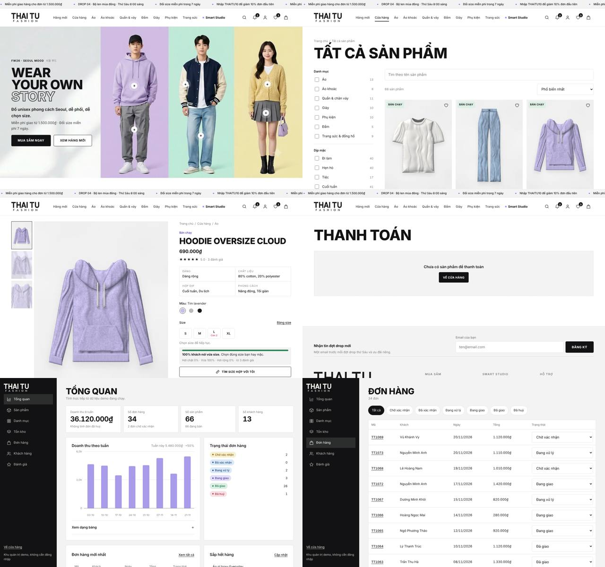

# 01 · Step 1: Review Prototype / Design

**Người thực hiện:** TV1 – lequangkhanh6002-pixel (PO/BA & Designer)
**Đầu vào:** `thai-tu-fashion-source.zip` (prototype tạo bằng Claude Design), đã import vào `frontend/`.
**Cách review:** mở toàn bộ các trang bằng Chrome headless ở 1280×800, đọc mã nguồn `js/*.js`, đối chiếu từng luồng người dùng.

## 1. Prototype đang có gì

| Khu vực | Trang (hash) | Nhận xét |
|---|---|---|
| Trang chủ | `#home` | Hero 3 người mẫu có hotspot "+", drop đếm ngược, gợi ý "Dành cho bạn" theo hành vi. |
| Cửa hàng | `#shop`, `#shop-new`, `#shop-tops`… | Lọc danh mục, dịp mặc, phong cách, khoảng giá, sắp xếp, tìm kiếm không dấu, gợi ý tức thì. |
| Chi tiết SP | `#product-{id}` | Chọn màu/size theo tồn kho, bảng size, đánh giá (lọc, sắp xếp, ảnh), báo khi có hàng, theo dõi giá. |
| Giỏ & thanh toán | `#cart`, `#checkout`, `#confirm-…` | Mã giảm giá THAITU10 / NEW50K / FREESHIP, 2 phương thức giao, COD/online (mô phỏng). |
| Tài khoản | `#account`, `#account-orders`, `#account-outfits`, `#account-wishlist`, `#account-measure`, `#account-notifs` | Hồ sơ, đơn hàng + theo dõi trạng thái, outfit đã lưu, yêu thích, số đo, thông báo. |
| Smart Studio | `#studio`, `#outfit`, `#size`, `#stylist`, `#visual`, `#tryon` | Outfit Builder, Size Advisor, AI Stylist, tìm bằng ảnh, thử đồ — đều chạy trong trình duyệt. |
| Quản trị | `#admin`, `#admin-products`, `#admin-categories`, `#admin-inventory`, `#admin-orders`, `#admin-customers`, `#admin-reviews` | Dashboard doanh thu, CRUD sản phẩm/danh mục, chỉnh tồn kho, đổi trạng thái đơn, ẩn/xoá đánh giá. |

Dữ liệu mẫu: 66 sản phẩm (k01–k24 minh hoạ, t01–t42 ảnh thật), 7 danh mục, 13 khách hàng, ~35 đơn, ~250 đánh giá, 3 mã giảm giá.

## 2. Điểm mạnh giữ nguyên

- Ngôn ngữ thiết kế nhất quán (Archivo + Be Vietnam Pro, nền trung tính, điểm nhấn lavender), responsive 768/1024/1200.
- Câu chữ tiếng Việt rõ ràng, thông báo lỗi cụ thể (ví dụ: "Số điện thoại cần có 10 chữ số và bắt đầu bằng 0").
- Luồng mua hàng đầy đủ, có kiểm tra tồn kho ở cả trang SP, giỏ và thanh toán.
- Admin có đủ màn hình vận hành cơ bản.

**Quyết định:** Step 3 **không vẽ lại giao diện**. Chỉ thêm màn hình còn thiếu (đăng nhập/đăng ký) theo đúng design system hiện có.

## 3. Vấn đề phát hiện (đầu vào cho PRD)

| ID | Mức độ | Vấn đề | Hệ quả | Hướng xử lý |
|---|---|---|---|---|
| DR-01 | Nghiêm trọng | Toàn bộ dữ liệu ở `localStorage`, không có server | Mỗi trình duyệt một "cửa hàng" riêng; admin đổi giá khách không thấy | Lưu trên Supabase Postgres, frontend đọc/ghi qua API |
| DR-02 | Nghiêm trọng | Giá, giảm giá, phí ship, trừ kho tính ở trình duyệt | Khách sửa JS là đổi được tổng tiền; bán vượt tồn kho khi 2 người mua cùng lúc | Tính tiền + trừ kho trong 1 transaction ở DB (`place_order`) |
| DR-03 | Nghiêm trọng | Không có đăng nhập; khách hiện tại gán cứng `c1` | Không phân biệt người dùng | Supabase Auth (email + mật khẩu), JWT |
| DR-04 | Nghiêm trọng | `#admin` mở cho mọi người | Ai cũng sửa được sản phẩm, đơn hàng | Vai trò `admin` trong `profiles`, kiểm tra ở API + RLS |
| DR-05 | Cao | Mã giảm giá viết cứng trong JS (`COUPONS`) | Lộ mã, không đổi được khi chạy | Bảng `coupons` (có hạn dùng, giới hạn lượt) |
| DR-06 | Cao | Chuyển trạng thái đơn tuỳ ý (đã giao → chờ xác nhận) | Sai lệch kho và báo cáo | Máy trạng thái có kiểm soát + lịch sử thay đổi |
| DR-07 | Trung bình | Đánh giá "đã mua" tính ở client | Gắn nhãn "đã mua" giả | Server tự xác định `verified` từ đơn đã giao |
| DR-08 | Trung bình | Thông báo giảm giá / có hàng lại chỉ sinh ra trong trình duyệt admin | Khách không nhận được | Trigger DB sinh `notifications` cho đúng người |
| DR-09 | Thấp | Thiếu `favicon` (404 khi tải trang) | Lỗi console | Thêm favicon |
| DR-10 | Thấp | Smart Studio (Stylist, Visual Search, Try-on) là mô phỏng | Ngoài phạm vi đợt này | Giữ mô phỏng phía client; chỉ lưu outfit/số đo lên server |

## 4. Màn hình cần bổ sung

1. **Đăng nhập / Đăng ký** (`#login`, `#register`): form email + mật khẩu, dùng lại `.input`, `.btn`, `.err` của prototype; có nút điền nhanh tài khoản demo.
2. **Trạng thái đã đăng nhập** ở header: icon người dùng dẫn tới `#account` khi đã đăng nhập, tới `#login` khi chưa; nút "Đăng xuất" trong trang tài khoản.
3. **Chặn quản trị**: vào `#admin*` khi chưa phải admin → chuyển sang `#login` kèm thông báo.
4. **Trạng thái kết nối**: nếu API không truy cập được, hiện toast "Đang dùng dữ liệu ngoại tuyến" và vẫn chạy chế độ demo như prototype.

## 5. Kết luận review

Prototype đạt yêu cầu về giao diện và luồng. Chuyển sang Step 2 với 10 vấn đề DR-01…DR-10 làm đầu vào cho PRD (`02-PRD.md`).
