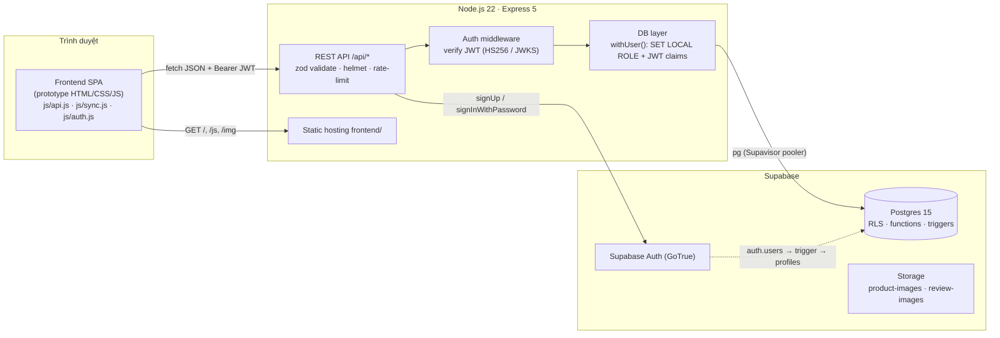
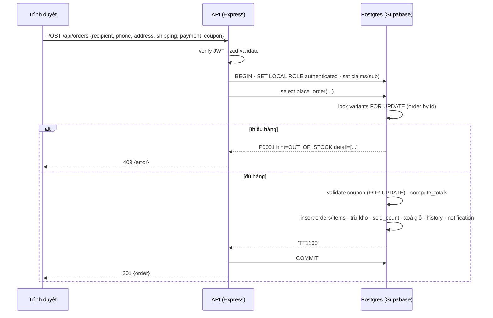
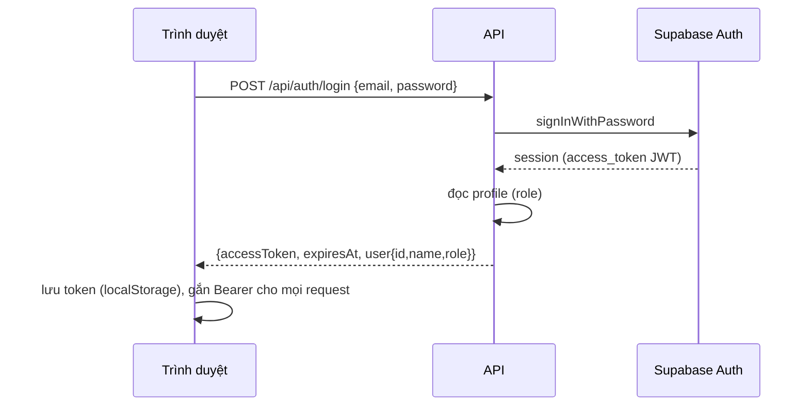

# 03 · Solution Architecture (How / Tech)

**Người viết:** TV2 – nguyen06-vn (Solution Architect) · **Review:** TV1, TV3
**Đầu vào:** PRD v1.0 (`02-PRD.md`), Design review (`01-design-review.md`)

## 1. Tổng quan



| Lớp | Công nghệ | Lý do |
|---|---|---|
| Frontend | Prototype HTML/CSS/JS thuần (giữ nguyên), thêm `api.js`, `sync.js`, `auth.js` | Không vẽ lại UI (quyết định Step 1); không cần build tool |
| Backend | Node.js 22, Express 5, `pg`, `zod`, `jose`, `helmet`, `express-rate-limit`, `@supabase/supabase-js` | Nhẹ, phổ biến, test dễ bằng `supertest` |
| Database | **Supabase Postgres** + RLS + PL/pgSQL | Một nguồn sự thật cho tiền & kho; RLS là lớp phân quyền thật |
| Auth | **Supabase Auth** (email + mật khẩu), JWT | Có sẵn, phát JWT chuẩn mà Postgres RLS đọc được qua `auth.uid()` |
| Test | Vitest (unit), Vitest + Supertest + Postgres thật (integration), Playwright + Chrome (e2e) | Đủ 3 tầng test như sơ đồ |
| CI | GitHub Actions (service container Postgres 16) | Chạy toàn bộ test mỗi lần push |

## 2. Quyết định kiến trúc (ADR)

### ADR-01 · Backend API đứng giữa, nói chuyện với Postgres bằng cơ chế của PostgREST
Frontend **không** gọi thẳng Supabase. Backend nhận JWT, rồi chạy mỗi request trong một transaction:

```sql
begin;
set local role authenticated;                                   -- hoặc anon nếu chưa đăng nhập
select set_config('request.jwt.claims', '{"sub":"<uid>","role":"authenticated"}', true);
-- ... các câu lệnh của request ...
commit;
```

Nhờ vậy **RLS của Supabase áp dụng y hệt như khi đi qua PostgREST** — backend có bug phân quyền thì DB vẫn chặn. Lý do không gọi Supabase trực tiếp từ trình duyệt: cần chỗ đặt validate, rate-limit, gom nhiều truy vấn thành một API, và để chạy test integration không phụ thuộc mạng.

### ADR-02 · Tiền và kho chỉ được tính trong Postgres
`cart_quote()` và `place_order()` (PL/pgSQL, `SECURITY DEFINER`) là nơi duy nhất tính tạm tính, giảm giá, phí ship, tổng. `place_order` khoá các biến thể `FOR UPDATE` theo thứ tự id, kiểm tra kho, ghi đơn, trừ kho, xoá giỏ, sinh thông báo **trong một transaction** → đáp ứng AC-ORD-01/02/03, xử lý DR-02.

### ADR-03 · Máy trạng thái đơn hàng trong DB
`order_next_statuses()` định nghĩa luồng hợp lệ; `_transition_order()` hoàn kho khi huỷ, cập nhật thanh toán, ghi `order_status_history`, báo cho khách. Backend có bản sao JS (`domain/orderStatus.js`) chỉ để trả `allowedNext` cho UI; test integration kiểm tra hai bản **khớp nhau** (contract test).

### ADR-04 · Thông báo sinh bằng trigger
Giảm giá (`products_price_drop`) và có hàng trở lại (`variants_restock`) là trigger DB → không phụ thuộc trình duyệt admin (DR-08).

### ADR-05 · Hai chế độ xác thực, cùng một định dạng token
| `AUTH_PROVIDER` | Đăng ký/đăng nhập | Xác minh token |
|---|---|---|
| `supabase` (production) | `supabase.auth.signUp / signInWithPassword` | HS256 với `SUPABASE_JWT_SECRET`, hoặc JWKS `…/auth/v1/.well-known/jwks.json` |
| `local` (dev/CI) | `local_auth_signup/login` (bcrypt trong `auth.users`, giống GoTrue) | HS256 với `JWT_SECRET` |

Cả hai đều cho JWT có `sub`, `role=authenticated`, `aud=authenticated` → phần còn lại của hệ thống không phân biệt.

### ADR-06 · Frontend: lớp đồng bộ thay vì viết lại
Prototype render từ biến toàn cục `S`. Thêm `sync.js`: khi khởi động tải dữ liệu từ API vào `S`, và **bọc** các hàm ghi (thêm giỏ, đặt hàng, sửa sản phẩm…) để gọi API trước, cập nhật `S` theo kết quả server. API lỗi mạng → chạy chế độ demo cục bộ như prototype (NFR-REL-01).

### ADR-07 · Mã lỗi nghiệp vụ thống nhất
Function SQL `raise exception … errcode 'P0001', hint '<CODE>'`. Backend map `hint` → HTTP:

| CODE | HTTP | Ví dụ |
|---|---|---|
| `AUTH_REQUIRED` | 401 | Chưa đăng nhập |
| `FORBIDDEN` | 403 | Không phải admin |
| `NOT_FOUND` | 404 | Đơn không tồn tại / không phải của bạn |
| `OUT_OF_STOCK`, `CONFLICT` | 409 | Hết hàng, email trùng, xoá danh mục còn SP |
| `VALIDATION`, `CART_EMPTY`, `COUPON_INVALID`, `INVALID_TRANSITION` | 422 | Dữ liệu sai, mã giảm giá sai, chuyển trạng thái sai |
| `PAYMENT_FAILED` | 402 | Thanh toán mô phỏng thất bại |

Body lỗi: `{ "error": { "code": "OUT_OF_STOCK", "message": "…", "details": … } }`.

## 3. Luồng chính

### Đặt hàng


### Đăng nhập


## 4. Cấu trúc repo

```
thai-tu-fashion/
├─ CLAUDE.md, .claude/skills/      Rule + Skill + Constraint cho AI coding agent
├─ docs/                           PRD, kiến trúc, ERD, API, plans, báo cáo test
├─ supabase/
│  ├─ config.toml                  Supabase CLI
│  ├─ migrations/                  001 schema · 002 functions/triggers · 003 RLS
│  ├─ seed.sql                     dữ liệu giả lập (sinh bởi scripts/gen-seed.mjs)
│  └─ local/                       shim Supabase + local auth (chỉ cho Postgres thường)
├─ backend/                        Express API + tests (unit, integration)
├─ frontend/                       SPA + e2e (Playwright)
├─ scripts/                        gen-seed, db-reset, trace
└─ .github/workflows/ci.yml
```

## 5. Bảo mật (NFR-SEC)

- RLS bật trên 18/18 bảng; anon chỉ đọc catalogue; `coupons` chỉ admin đọc (khách kiểm tra qua `cart_quote`) → xử lý DR-05.
- Trigger `profiles_protect_role` chặn khách tự nâng quyền admin.
- Service role key / DB URL / JWT secret chỉ ở `.env` của backend; frontend chỉ biết URL API.
- `helmet`, CORS theo `CORS_ORIGINS`, rate-limit 20 req/phút cho `/api/auth/*`, body JSON tối đa 200 KB.

## 6. Triển khai

| Môi trường | Database | Auth | Lệnh |
|---|---|---|---|
| Local nhanh (không Docker) | Postgres 16 local + shim | `local` | `scripts/db-reset.sh && npm --prefix backend start` |
| Local đầy đủ Supabase | `supabase start` (Docker) | `supabase` | `supabase db reset` rồi chạy backend với key in ra |
| Production | Supabase Cloud (`supabase db push`) | `supabase` | Backend lên Render/Fly/Railway, `STATIC_DIR=../frontend` |
