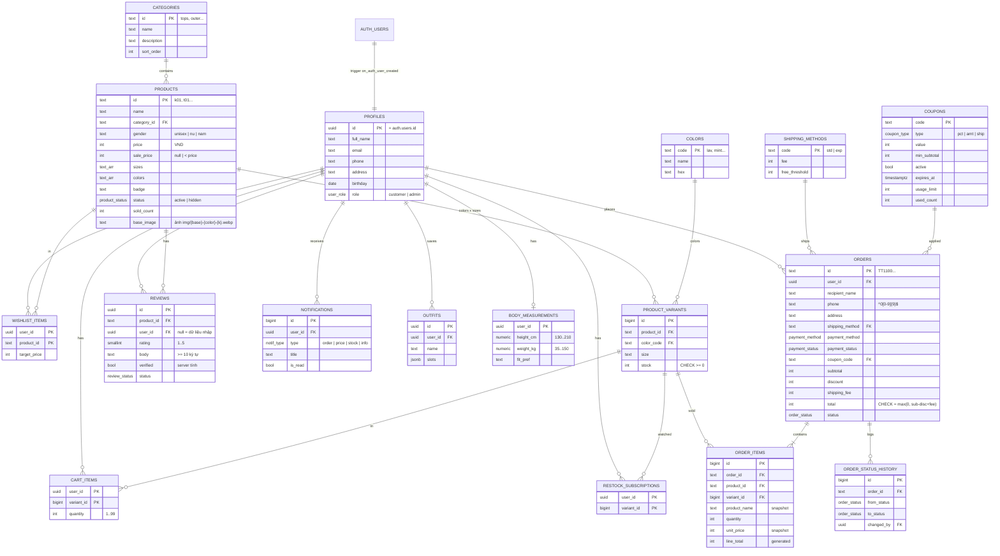

# 04 · Database Schema (ERD) – Supabase Postgres

**Người viết:** TV2 – nguyen06-vn · **Nguồn sự thật:** `supabase/migrations/*.sql`

## 1. Sơ đồ quan hệ

Ngoài ra: `newsletter_subscribers(email PK)`, view `product_rating_stats(product_id, rating_avg, rating_count)` (security_invoker).

## 2. Quy tắc dữ liệu đáng chú ý

| Quy tắc | Cài đặt | AC |
|---|---|---|
| Tồn kho không âm | `CHECK (stock >= 0)` + khoá `FOR UPDATE` trong `place_order` | AC-ORD-02/03 |
| Tổng tiền nhất quán | `CHECK (total = greatest(0, subtotal - discount + shipping_fee))` | AC-CART-03 |
| Giá sale < giá gốc | `products_sale_lt_price` | AC-ADM-02 |
| Biến thể = màu × size | trigger `products_sync_variants` (biến thể mới = 10, biến thể bị bỏ thì xoá) | AC-ADM-02 |
| Snapshot đơn hàng | `order_items.product_name`, `unit_price` lưu tại thời điểm mua | AC-ORD-04 |
| Không xoá danh mục còn SP | FK `on delete restrict` → API trả 409 | AC-ADM-03 |
| Mã đơn dạng `TTxxxx` | `default 'TT' || nextval('order_number_seq')` | AC-ORD-01 |

## 3. Functions & triggers

| Tên | Loại | Vai trò |
|---|---|---|
| `handle_new_user` | trigger `auth.users` | tạo `profiles` khi đăng ký |
| `tg_protect_profile_role` | trigger | chặn tự nâng quyền |
| `tg_sync_product_variants` | trigger | đồng bộ biến thể |
| `tg_notify_price_drop` | trigger | thông báo giảm giá cho người thích |
| `tg_notify_restock` | trigger | thông báo có hàng, huỷ đăng ký |
| `tg_review_defaults` | trigger | tính `verified`, ép `status=visible` với khách |
| `is_admin()` | function | dùng trong RLS |
| `cart_quote(shipping, coupon)` | RPC | báo giá giỏ |
| `place_order(...)` | RPC | đặt hàng nguyên tử |
| `cancel_my_order(id)` | RPC | khách huỷ đơn `pending` |
| `admin_set_order_status(id, status, note)` | RPC | admin đổi trạng thái |
| `admin_dashboard()` | RPC | số liệu tổng quan |
| `subscribe_newsletter(email)` | RPC | đăng ký nhận tin |

## 4. Ma trận RLS

| Bảng | anon | authenticated (khách) | admin |
|---|---|---|---|
| categories, colors, shipping_methods | đọc | đọc | đọc/ghi |
| products, product_variants | đọc SP `active` | đọc SP `active` | đọc tất cả, ghi |
| reviews | đọc `visible` | đọc `visible` + của mình; thêm của mình; xoá của mình | đọc/sửa/xoá tất cả |
| profiles | — | đọc/sửa của mình (không đổi `role`) | đọc/sửa tất cả |
| cart_items, wishlist_items, restock_subscriptions, outfits, body_measurements | — | CRUD của mình | (như khách) |
| notifications | — | đọc/đánh dấu/xoá của mình | (như khách) |
| orders, order_items, order_status_history | — | đọc của mình; ghi qua RPC | đọc tất cả; ghi qua RPC |
| coupons | — | — (kiểm tra qua `cart_quote`) | CRUD |
| newsletter_subscribers | ghi qua RPC | ghi qua RPC | đọc |

## 5. Dữ liệu giả lập

`node scripts/gen-seed.mjs` đọc catalogue của prototype và sinh `supabase/seed.sql`:

| Bảng | Số dòng |
|---|---|
| auth.users / profiles | 14 (1 admin, 13 khách) |
| categories / colors / shipping_methods | 7 / 23 / 2 |
| products / product_variants | 66 / 319 (tổng tồn kho ≈ 2.950) |
| reviews | 262 |
| orders (+ items, history) | 34 |
| coupons | 5 (3 của prototype + `SUMMER25` đã hết hạn + `VIP100K` giới hạn lượt) |
