# Wireframes — Thai Tu Fashion (Task 1b)

**Người vẽ:** TV1 – lequangkhanh6002-pixel · Issue [#1](https://github.com/huynhsy986-droid/thai_tu_fashion/issues/1)

Wireframe low-fidelity (đen trắng, chỉ bố cục) cho **10 trang chính**, mỗi trang có bản **Desktop 1280px** và **Mobile 390px**. Số đỏ trên hình ứng với chú thích ở cuối mỗi khung.

- Trang 01–08 được dựng lại từ prototype đã duyệt ở Step 1 (`docs/01-design-review.md`) để lưu hồ sơ thiết kế.
- Trang 09 Giới thiệu và 10 Liên hệ là trang mới bổ sung theo Final Project Brief (PRD F9).
- Nguồn có thể sửa: `src/build.py` (bố cục) → `src/wireframes.html`; xuất PNG: `node docs/wireframes/src/render.mjs`.

| # | Trang | Route | Desktop | Mobile |
|---|---|---|---|---|
| 1 | Trang chủ | `#home` | [01-home-desktop.png](01-home-desktop.png) | [01-home-mobile.png](01-home-mobile.png) |
| 2 | Cửa hàng / danh mục | `#shop` | [02-shop-desktop.png](02-shop-desktop.png) | [02-shop-mobile.png](02-shop-mobile.png) |
| 3 | Chi tiết sản phẩm | `#product-k01` | [03-product-desktop.png](03-product-desktop.png) | [03-product-mobile.png](03-product-mobile.png) |
| 4 | Giỏ hàng | `#cart` | [04-cart-desktop.png](04-cart-desktop.png) | [04-cart-mobile.png](04-cart-mobile.png) |
| 5 | Thanh toán | `#checkout` | [05-checkout-desktop.png](05-checkout-desktop.png) | [05-checkout-mobile.png](05-checkout-mobile.png) |
| 6 | Đăng nhập / Đăng ký | `#login` | [06-login-desktop.png](06-login-desktop.png) | [06-login-mobile.png](06-login-mobile.png) |
| 7 | Tài khoản & đơn hàng | `#account-orders` | [07-account-desktop.png](07-account-desktop.png) | [07-account-mobile.png](07-account-mobile.png) |
| 8 | Quản trị — Tổng quan & Đơn hàng | `#admin` | [08-admin-desktop.png](08-admin-desktop.png) | [08-admin-mobile.png](08-admin-mobile.png) |
| 9 | Giới thiệu | `#about` | [09-about-desktop.png](09-about-desktop.png) | [09-about-mobile.png](09-about-mobile.png) |
| 10 | Liên hệ | `#contact` | [10-contact-desktop.png](10-contact-desktop.png) | [10-contact-mobile.png](10-contact-mobile.png) |

## Xem nhanh

### Trang chủ

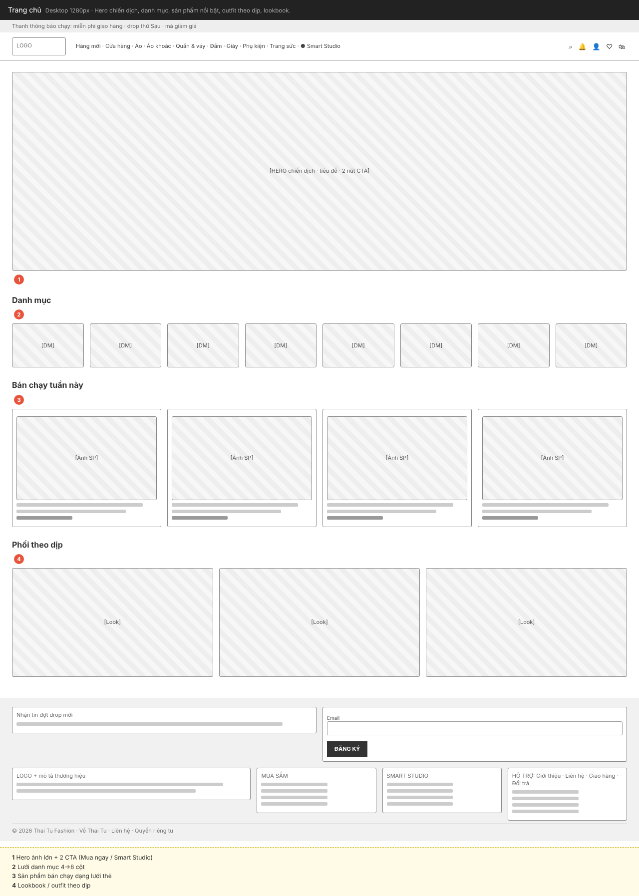 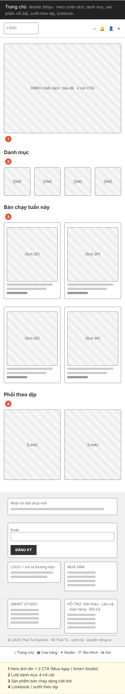

### Cửa hàng / danh mục

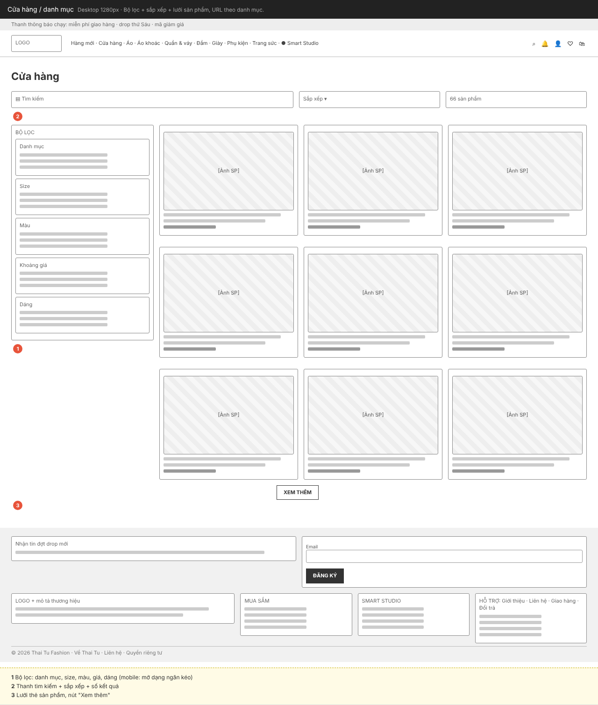 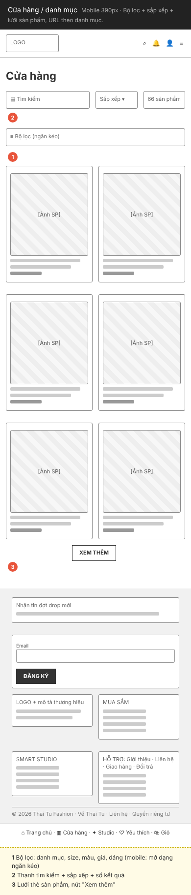

### Chi tiết sản phẩm

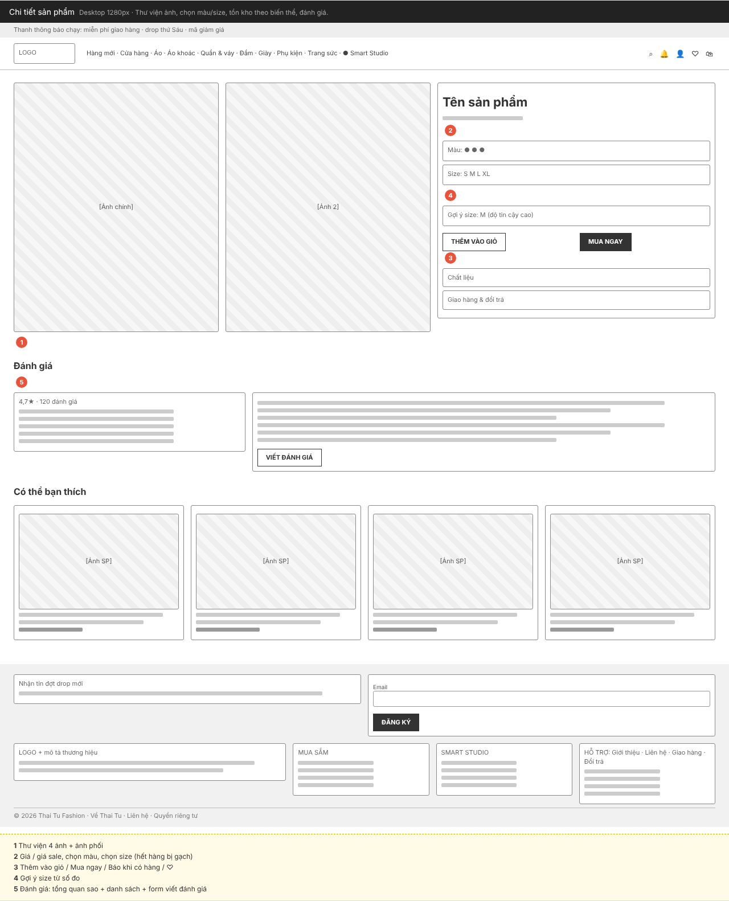 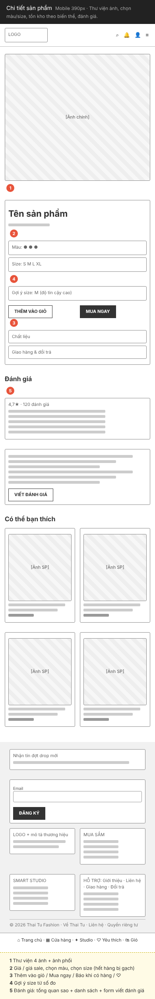

### Giỏ hàng

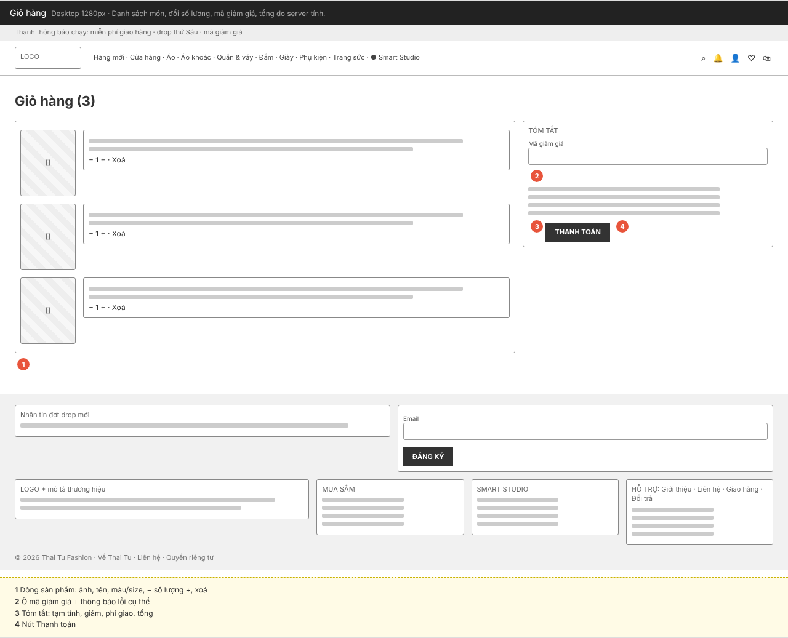 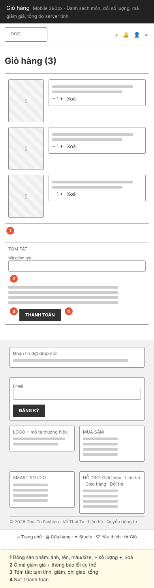

### Thanh toán

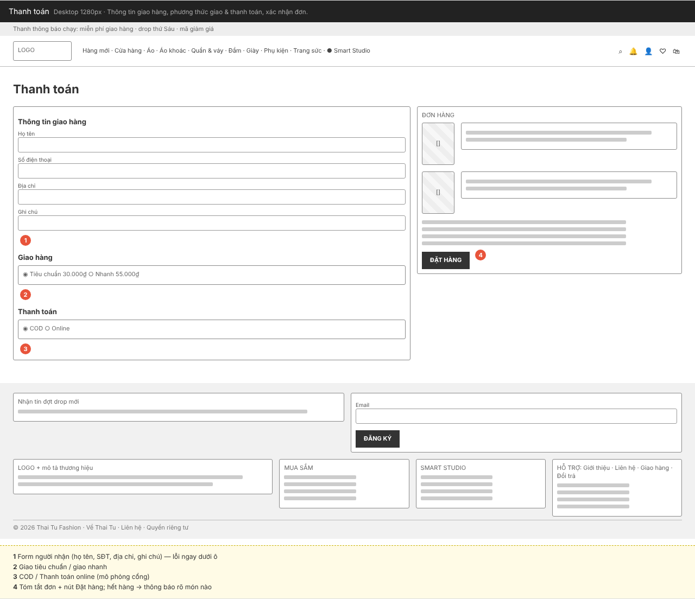 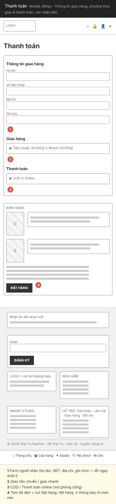

### Đăng nhập / Đăng ký

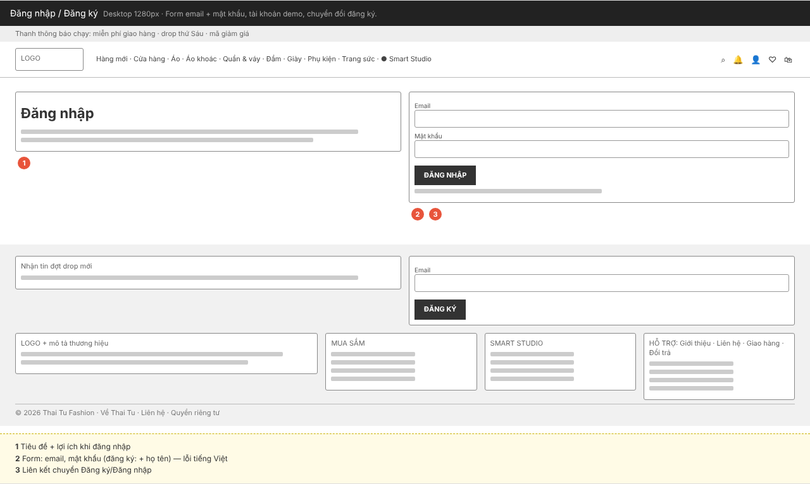 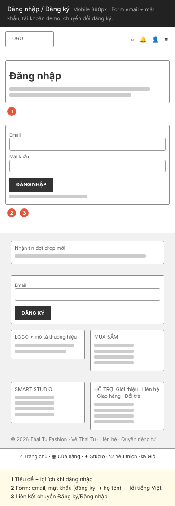

### Tài khoản & đơn hàng

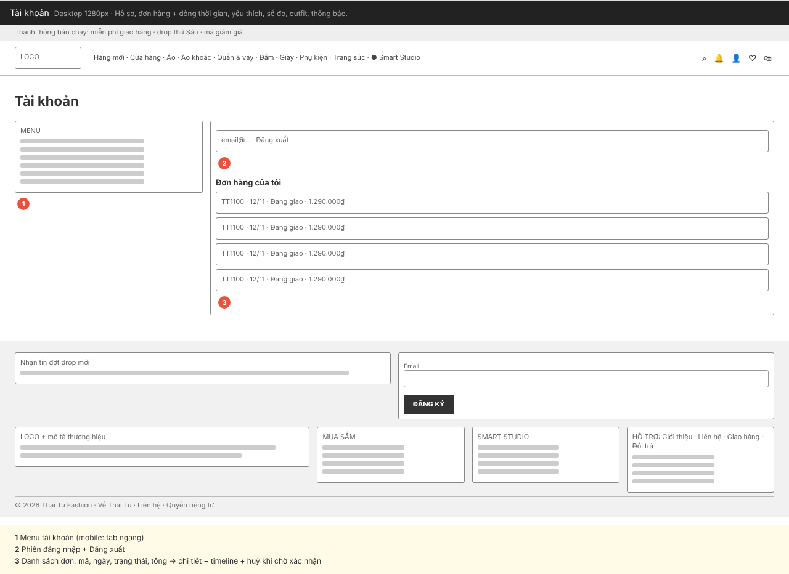 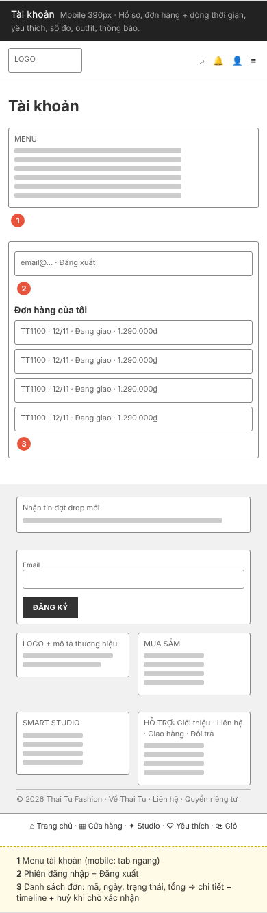

### Quản trị — Tổng quan & Đơn hàng

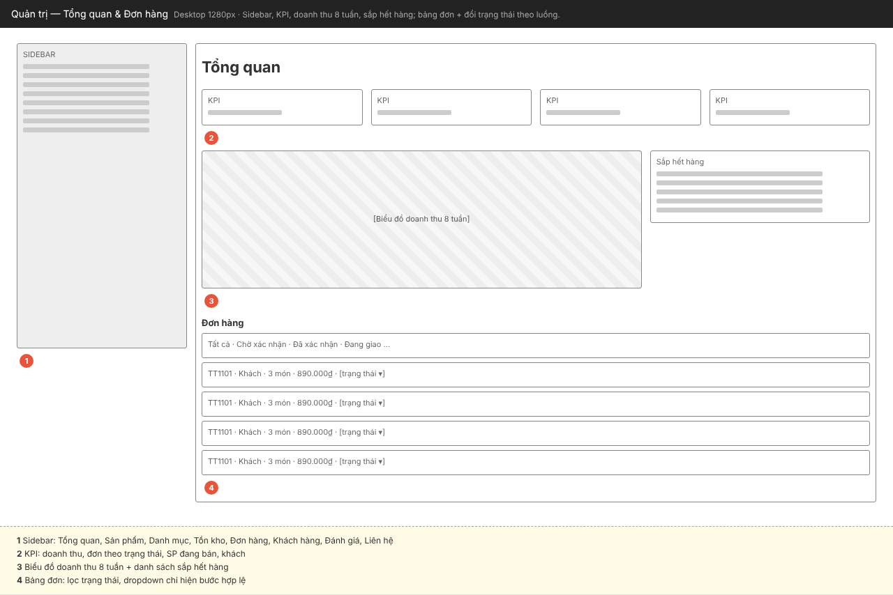 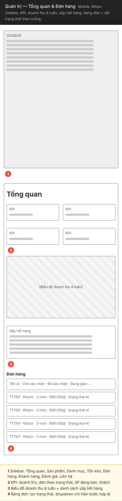

### Giới thiệu

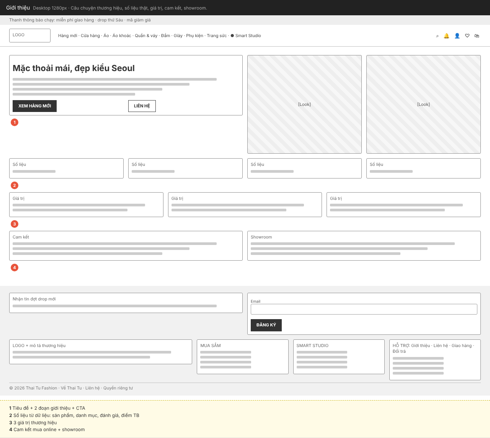 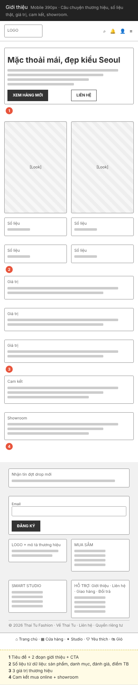

### Liên hệ

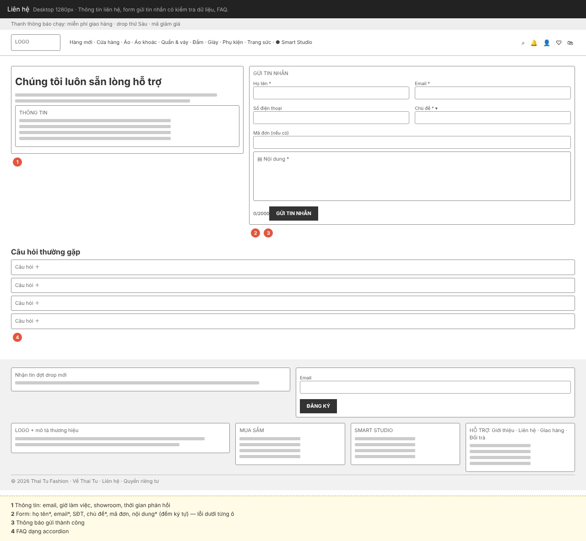 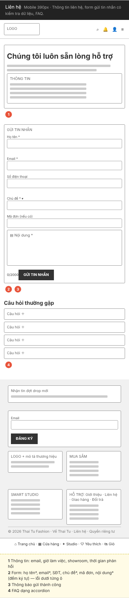

## Bảng duyệt wireframe

Mỗi thành viên xem toàn bộ wireframe, ghi nhận xét và đánh dấu đồng ý. *Mỗi người tự điền dòng của mình (không điền hộ).*

| Thành viên | Vai trò | Ngày duyệt | Đồng ý | Góp ý |
|---|---|---|---|---|
| lequangkhanh6002-pixel | PO/BA · người vẽ | 27/11/2026 | ✓ | Nhóm Tam Thái Tử Fashion có wireframe đủ desktop và mobile, phân vai rõ ràng, tài liệu đánh số gọn. |
| nguyen06-vn | Backend |27/11/2026 | ✓ |Cần bổ sung trạng thái lỗi/trống dữ liệu, validate form (login,contact) và luồng kiểm tra tồn kho/trạng thái đơn khi nối API (cart,checkout,admin) |
| huynhsy986-droid | Frontend & QA | 27/11/2026 | ✓ | Bản mobile rõ ràng; nên thêm trạng thái đang tải (skeleton) cho trang chủ và cửa hàng.|
